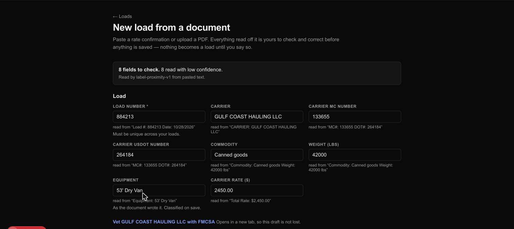
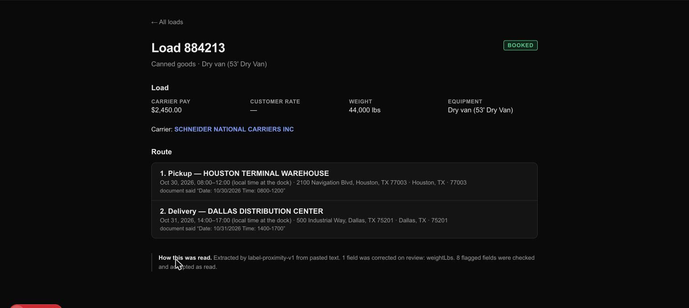
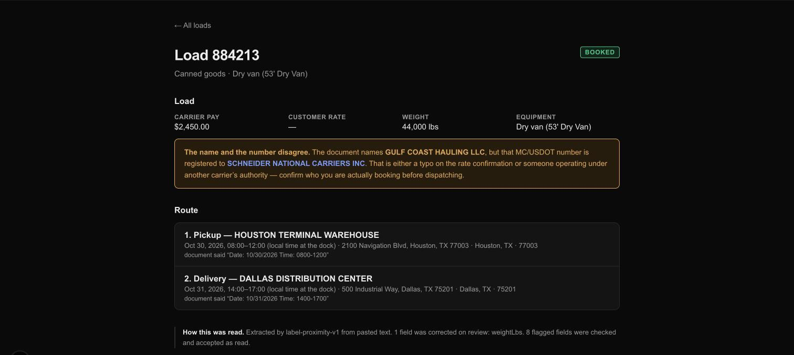
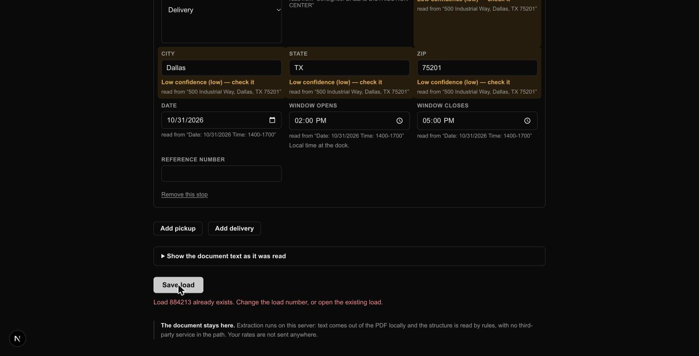
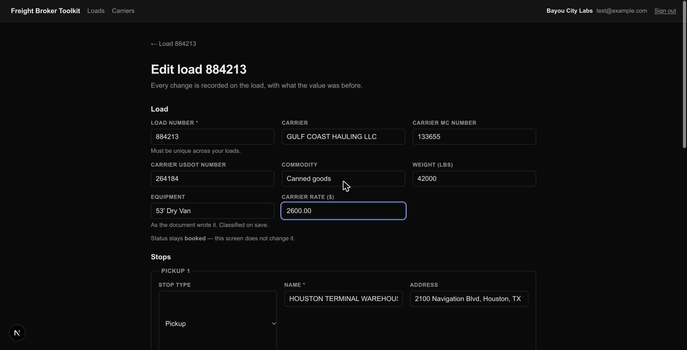
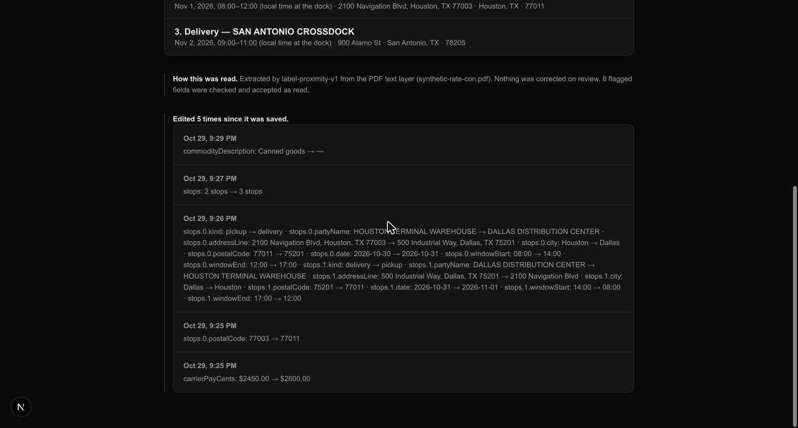

# Load intake: what it looks like, and how to try it

Screenshots of every screen a load passes through — read, review, save, and
correct afterwards — with paste-ready documents to reproduce them. Everything
here runs locally against synthetic documents — no API key, no network,
nothing leaves the machine.

Architecture and the reasoning behind it are in [`../CLAUDE.md`](../CLAUDE.md).

## Running it

```bash
npm run db:up && npm run db:migrate
npm run db:seed -- you@example.com   # creates a brokerage for your user
npm run dev
```

Sign in at <http://localhost:3000/signin>, then go to **Loads → New load from
a document**. Sign-in emails a magic link, so `AUTH_RESEND_KEY` and
`AUTH_EMAIL_FROM` need to be set and the link only delivers to the Resend
account owner.

## 1. Reading a document

Paste this into the box and press **Read the document**. It is
[`fixtures/intake/synthetic-rate-con.txt`](../fixtures/intake/synthetic-rate-con.txt);
the same content as a PDF is at
[`fixtures/intake/synthetic-rate-con.pdf`](../fixtures/intake/synthetic-rate-con.pdf)
if you want to exercise the upload path instead.

```
ACME LOGISTICS LLC          RATE CONFIRMATION
Load #: 884213              Date: 10/28/2026

CARRIER: GULF COAST HAULING LLC
MC#: 133655     DOT#: 264184

PICKUP
Shipper: HOUSTON TERMINAL WAREHOUSE
2100 Navigation Blvd, Houston, TX 77003
Date: 10/30/2026   Time: 0800-1200

DELIVERY
Consignee: DALLAS DISTRIBUTION CENTER
500 Industrial Way, Dallas, TX 75201
Date: 10/31/2026   Time: 1400-1700

Commodity: Canned goods     Weight: 42000 lbs
Equipment: 53' Dry Van
Total Rate: $2,450.00
```

> **Keep the column spacing.** The runs of spaces are not decoration — the
> parser reads structure from the geometry, and collapsing them changes what
> it finds. See "two fields on one row" in CLAUDE.md.



Worth noticing:

- **Flags sit on the field**, not in a list somewhere else. The address parts
  are marked because they were found by shape rather than next to a label.
- **`read from "…"`** under each field is the text it came from, so a flag can
  be judged without reopening the document.
- **The rate is in dollars** in the box and integer cents underneath.
- **Vetting is one click away**, with the MC number carried over. This is
  where the two modules meet.

Things to try: clear the load number and try to save (it is required); type
`eleven thousand` into the weight (it refuses rather than silently storing
nothing); add or remove a stop; open **Show the document text as it was read**
to see what the text stage produced.

## 2. Saving it

Press **Save load**. Nothing is written until you do.



- The route is in sequence, with each window as **local wall time at the
  dock** and the document's own words kept underneath. Intake never converts a
  window to an absolute instant — the document rarely says which timezone it
  means.
- **How this was read** records the parser, the source, and which fields you
  corrected. That is the evidence the confidence scale eventually gets tuned
  from.

**This screenshot is also a bug, caught before it was fixed.** The document
says GULF COAST HAULING LLC; the page says SCHNEIDER NATIONAL CARRIERS INC,
with nothing marking the disagreement. Read on.

## 3. When the name and the number disagree

Intake links a load to a carrier by **MC or USDOT number**, because that is
what a rate confirmation states precisely while a name gets written a dozen
ways. So what happens when the number resolves to a different company than the
document names?

That is not a cosmetic mismatch. It is the signature of **double brokering or
carrier identity theft** — a rate con arriving under a legitimate carrier's
authority with somebody else's name on it. FMCSA's public data cannot detect
it. We can, for free, because we hold both halves.



To reproduce it, you need a carrier on file whose number matches the document
but whose name does not. Vet `MC-133655` first (it belongs to Schneider
National), then import the rate con above, which names GULF COAST HAULING LLC
under that same number.

Corporate form and punctuation are normalized first, so "Gulf Coast Hauling,
L.L.C." does **not** trip the warning against "GULF COAST HAULING LLC". A
warning that cries wolf stops being read.

## 4. Importing the same document twice

Reference numbers are unique per brokerage. Press **Read the document** on the
same text again and save it.



Reported, never silently suffixed — two loads under one number on a broker's
paperwork is a problem they need to see, and the usual cause is importing the
same rate con twice. The form keeps its values so you can change the number
and resubmit.

## 5. Correcting a saved load

A load used to be frozen once saved: a wrong rate meant re-importing under a
new number. **Edit load** on the load page opens the same fields again.



Any field, the whole route — add a stop, remove one — and the address of the
facility behind each stop. There is no move control: reordering means retyping
the rows into each other, which the trail then reports field by field, or
removing a stop and adding it back, which it reports as one stop leaving the
route and another joining. Three things are worth knowing before you use it:

- **Correcting an address fixes the facility everywhere.** The address lives on
  the shared `Party` row, not on the stop, so a wrong ZIP is wrong on every
  load that touches that dock and gets fixed on all of them. Typing a
  _different name_ is the other thing entirely: it points this stop at another
  facility, and never renames the one other loads depend on.
- **Status is not editable here.** It is still whatever intake inferred, so a
  load that saved as a draft for want of a rate stays a draft after you fill
  the rate in. A real lifecycle needs discovery, not invention.
- **The carrier number boxes are load-bearing.** A load stores a carrier
  _link_, not the numbers somebody typed, so the form prefills them from the
  linked carrier. Clearing them unlinks the load from its vetting history —
  which is allowed, and is now recorded.

Every save appends what changed to the load, and the load page shows it:



Newest first, one line per field, with the value it held before. It is a
sibling of **How this was read**, never part of it — those corrections are
evidence about the _parser_, captured the moment a human overruled it, and
diluting them with edits made days later would ruin the only data the
confidence scale can be tuned from.

**That screenshot also shows a defect**, in the route above the trail: stop 2
reads `… Houston, TX 77003 · Houston, TX · 77011`. The ZIP was corrected to
77011 and the stale 77003 is still sitting in the address line beside it. See
[one address, stored twice](#7-what-it-cannot-do-yet) — it is a parser
decision, not an edit-screen one, and editing is what made it dangerous.

The timestamp is an instant in **CT**, where a dock window is wall time with no
zone at all. That asymmetry is deliberate: an edit happened at a knowable
moment, and a rate con's `0800` does not say which clock it means.

A trail that lies is worse than no trail, because it gets believed. So: a date
you type with no time alongside it is not storable today, and is not reported
as saved. The facility lines state the dock **as stored**, not as typed — so
retyping a name in a different case reports nothing, because nothing is
renamed, and pointing a stop at a dock you already hold reports the address it
actually adopted rather than the boxes you cleared. And the carrier link is
reported in either direction, because the difference between "this carrier's
authority and insurance were checked" and "nobody checked" is the one change
that must never be silent.

## 6. Looking at documents without the UI

The corpus inspector reports what the pipeline sees, with no server and no
database:

```bash
npm run intake:inspect -- fixtures/intake/synthetic-rate-con.pdf
```

Per document: pages with image coverage and a needs-OCR flag, the assembled
lines with their column breaks, the layout fingerprint, and the draft with
per-field confidence. `--items` adds every positioned text item and the plain
text; `--quiet` drops the line dump.

Given several documents it also clusters them:

```bash
npm run intake:inspect -- --quiet fixtures/intake/*.txt
```

```
Layout clusters
  3 documents, 3 distinct layout(s)

Pairwise similarity
  0.94  sample-rate-con-b.txt ↔ synthetic-rate-con.txt
```

Two rate confirmations off the same form score **0.94**; a different vendor's
tender does not even reach the 0.30 reporting floor. That contrast is the
whole instrument — it is how "do rate con layouts cluster by TMS vendor or by
shipper?" gets answered from real documents instead of argued about.

Why 0.94 rather than 1.00, when the two really are the same form: the longer
commodity name in the second document narrows the gap before `Weight:` below
the column-break threshold, so that one anchor drops out. Value lengths
perturb the geometry. This is exactly why similarity is **reported rather than
thresholded** — where the line sits between "same form" and "different form"
is a judgement about real documents, and hardcoding it before seeing any would
be guessing.

## 7. What it cannot do yet

- **Scans and faxes.** A page with no text layer needs OCR, which is not
  built — the screen says so rather than producing an empty draft. OCR does
  not fit in a request handler, so it needs a job queue.
- **Per-layout templates.** Today there is one generic label-proximity parser.
  Templates should be written where they measurably beat it, which needs real
  documents.
- **Deleting a load.** Editing exists now (section 5); deleting does not. A bad
  import gets corrected rather than removed.
- **Setting a load's status.** Inferred at intake and never settable by hand.
- **A date with no time.** A stop stores a window as a date _and_ a time
  together, so a document stating "Delivery 11/03" with no appointment window
  loses the date — on the intake path as much as the edit path. The edit trail
  stays silent about it rather than reporting a save that did not happen, which
  is honest but not a fix.
- **One address, stored twice.** The parser puts the whole address line into
  the facility's `addressLine1` _and_ splits out city, state and ZIP, and the
  load page prints all four. Correct the ZIP in the field labelled ZIP and the
  old one is still sitting in the address line beside it. Harmless while
  nothing could be edited; misleading now that it can.
- **Timezones per facility.** A stop stores the facility's zone only if the
  party has one, and nothing sets one yet. The screen says "local time at the
  dock" rather than guessing from the state on the address.

## Sample documents

| File                                                                                                                        | What it is for                                                                                                            |
| --------------------------------------------------------------------------------------------------------------------------- | ------------------------------------------------------------------------------------------------------------------------- |
| [`synthetic-rate-con.txt`](../fixtures/intake/synthetic-rate-con.txt) / [`.pdf`](../fixtures/intake/synthetic-rate-con.pdf) | The main sample, as pasted text and as a digital PDF                                                                      |
| [`sample-rate-con-b.txt`](../fixtures/intake/sample-rate-con-b.txt)                                                         | A second load on the **same form** — pairs with the first for the cluster report                                          |
| [`sample-tender-other-vendor.txt`](../fixtures/intake/sample-tender-other-vendor.txt)                                       | A **different vendor's** tender: different labels, different places, and a good look at where the generic parser gives up |

All synthetic. See
[`fixtures/intake/README.md`](../fixtures/intake/README.md) for why that is
both necessary and not sufficient.
